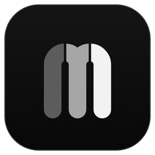
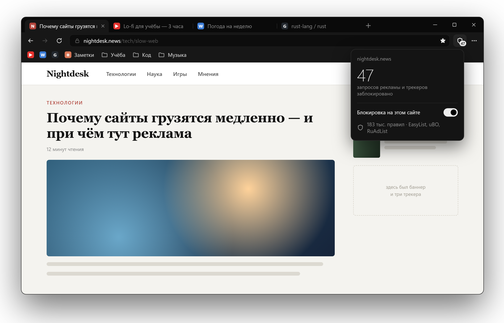

<div align="center">



# Mono

**Чёрно-белый браузер для Windows 11 на Rust**

Быстрый, лёгкий и без рекламы: свой блокировщик на 180 тысяч правил, ленивые вкладки и ничего лишнего в интерфейсе.

[](https://github.com/trualontuu/mono/releases/latest/download/Mono.zip)


[](https://github.com/trualontuu/mono/releases/latest)



<sub>Макет: сайты и вкладки выдуманные.</sub>

</div>

## Установка

> Нужна Windows 11 (64-бит). Движок WebView2 в Windows 11 уже есть, ставить ничего не нужно.

1. Скачай **[Mono.zip](https://github.com/trualontuu/mono/releases/latest/download/Mono.zip)** и распакуй в любую папку, например `%LOCALAPPDATA%\Programs\Mono`.
2. Запусти `mono.exe`. Один файл, около 6 МБ.
3. При первом запуске Mono сам перенесёт закладки и историю из Chrome. Пароли — по шагам на странице «Настройки → Импорт из Chrome».

<details>
<summary><b>Windows пишет «Windows защитила ваш компьютер»</b></summary>

Программа не подписана платным сертификатом. Нажми **«Подробнее» → «Выполнить в любом случае»**. Окно появляется только при первом запуске.
</details>

<details>
<summary><b>Почему пароли Chrome не переносятся сами</b></summary>

С версии 127 Chrome шифрует пароли ключом, привязанным к самому Chrome (App-Bound Encryption), — посторонняя программа их прочитать не может, и это правильно. Поэтому: `chrome://password-manager/settings` → «Экспорт паролей» → выбери полученный CSV в настройках Mono. После импорта файл лучше удалить. В Mono пароли хранятся зашифрованными через Windows DPAPI.
</details>

<details>
<summary><b>Сайт сломался из-за блокировщика</b></summary>

Нажми на щит справа от адресной строки и выключи блокировку для этого сайта. Списки фильтров обновляются сами раз в несколько дней.
</details>

<details>
<summary><b>Как удалить</b></summary>

Закрой Mono и удали папку с `mono.exe`. Данные (история, закладки, пароли, кэш) лежат в `%LOCALAPPDATA%\Mono` — удали и её.
</details>

## Что умеет

| | |
|---|---|
| 🛡 **Блокировщик рекламы** | движок adblock-rust (Brave), списки EasyList, EasyPrivacy, uBlock Origin и RuAdList — режет и запросы, и пустые места от баннеров; отдельная защита от рекламы в роликах YouTube |
| ⚡ **Быстрый** | запуск за ~0,4 с, вкладки грузятся только когда их открывают, фоновые засыпают и отдают память; ссылки сайта подгружаются заранее при наведении |
| 🔑 **Пароли** | подставляет сохранённые логины и предлагает запомнить новые; всё шифруется DPAPI и не покидает компьютер |
| ⭐ **Быстрый доступ** | панель закладок с папками, как в Chrome, — <kbd>Ctrl</kbd>+<kbd>Shift</kbd>+<kbd>B</kbd> |
| 🔎 **Умная адресная строка** | подсказки из закладок, истории и поисковика, автодополнение; Google, Яндекс, DuckDuckGo или Bing |
| 🪶 **Минимализм** | чёрно-белый интерфейс без лишних кнопок, своя рамка окна, цветные только значки сайтов |

### Клавиши

| | |
|---|---|
| <kbd>Ctrl</kbd>+<kbd>T</kbd> · <kbd>Ctrl</kbd>+<kbd>W</kbd> | новая / закрыть вкладку |
| <kbd>Ctrl</kbd>+<kbd>Shift</kbd>+<kbd>T</kbd> | вернуть закрытую вкладку |
| <kbd>Ctrl</kbd>+<kbd>Tab</kbd> · <kbd>Ctrl</kbd>+<kbd>1</kbd>…<kbd>9</kbd> | переключить вкладку |
| <kbd>Ctrl</kbd>+<kbd>L</kbd> | адресная строка |
| <kbd>Ctrl</kbd>+<kbd>D</kbd> | в закладки |
| <kbd>Ctrl</kbd>+<kbd>H</kbd> · <kbd>Ctrl</kbd>+<kbd>Shift</kbd>+<kbd>O</kbd> | история / закладки |
| <kbd>Ctrl</kbd>+<kbd>J</kbd> | загрузки |
| <kbd>F11</kbd> · <kbd>F12</kbd> | полный экран / инструменты разработчика |

## Для разработчиков

<details>
<summary><b>Сборка из исходников</b></summary>

Нужны [Rust](https://rustup.rs) и Visual Studio Build Tools (C++).

```
git clone https://github.com/trualontuu/mono
cd mono
cargo build --release
```

Готовый файл — `target\release\mono.exe`. Интерфейс (`ui/`) вшит в exe.

Устройство: окно на Win32 со своей рамкой, WebView2 через COM напрямую (`webview2-com`, без wry/tauri): отдельный webview для панели, для всплывающих меню и по одному на вкладку. Блокировка — перехват `WebResourceRequested` + косметические правила через `adoptedStyleSheets`. История, закладки и пароли — SQLite (`rusqlite`).

Тестовый запуск, не мешающий основному: переменные `MONO_DATA=<папка>` (отдельные данные) и `MONO_TEST=1` (окно за пределами экрана, без фокуса).
</details>
